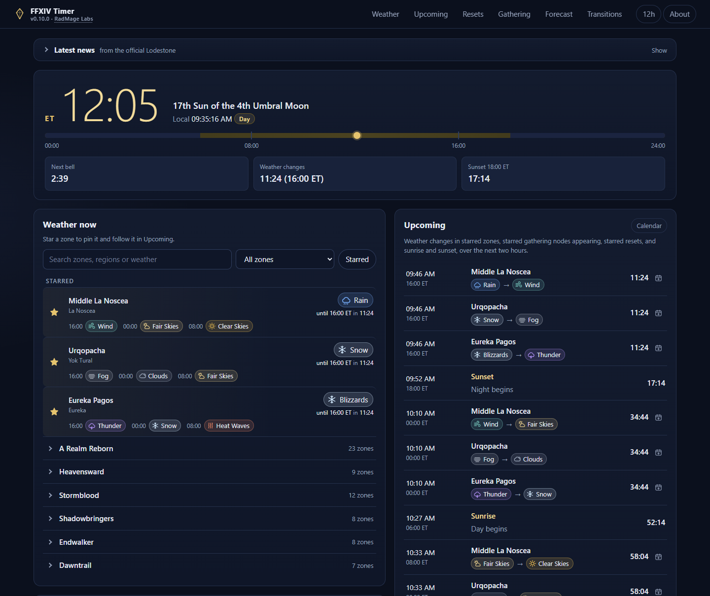

# FFXIV Timer v0.10.0

Eorzea Time, weather forecasts, weather transitions, resets, timed gathering nodes and market board
prices for FINAL FANTASY XIV. No account and nothing to install. Your settings stay in your browser;
the page asks for nothing beyond itself until you open Latest news or Market & Crafting.



The build is made to be served at two addresses, with the first as the canonical one:

- https://radmagelabs.com/ffxiv/
- https://radmageirl.github.io/ffxiv-timer/

## What it does

The page has two modes, switched with the buttons at the top: **Timers & Weather** (everything
below up to Latest news) and **Market & Crafting** (market board prices).

- **Eorzea clock.** ET time, the Eorzean date (sun and moon), local time, day or night, and
  countdowns to the next bell, the next weather change and the next sunrise or sunset.
- **Weather now.** Current weather in every supported zone, how long it lasts, and the next
  three changes. Search by zone, region or current weather; filter by region; star zones.
- **Upcoming.** One timeline of weather changes in starred zones plus sunrise and sunset, and of
  starred nodes and starred resets.
- **Resets.** The daily reset, the Mini Cactpot, Grand Company missions, leve allowances, the
  weekly reset, your data center's Jumbo Cactpot drawing and the housing lottery's current
  period, each in your time zone (named on the page) with its UTC time beside it, since guides
  give reset times in UTC and the Lodestone in Pacific time. Times that only community sources
  give are marked "time unverified". Starred resets show in Upcoming and can remind you when they
  happen or up to 30 minutes before, while the page is open.
- **Add to calendar.** Calendar buttons in Upcoming, Resets, Timed gathering and Weather
  transitions make a calendar file (.ics) of the times you choose, with an optional alarm. The
  calendar tool loads from this site the first time you use it; the page writes the file itself
  and sends nothing. Each entry is a UTC start, so a calendar shows it in its own time zone;
  something already under way starts when the file is made, and a file holds at most 500
  entries.
- **Forecast.** Any supported zone's weather odds and its next 12 to 72 weather periods, each with
  the weather before it.
- **Weather transitions.** Find when a zone changes from one weather to another ("Fog, then Heat
  Waves"), optionally only at 00:00, 08:00 or 16:00 ET, up to 30 days ahead. The search is in
  the address, so a link shares it and a reload or bookmark keeps it.

- **Timed gathering.** Every timed unspoiled and legendary node from A Realm Reborn through
  Dawntrail (189), with its items (level, stars, collectable), job and level, zone, area and map
  coordinates, folklore tome and spawn times. The list shows the nodes up now, ending soonest
  first, then the ones appearing within the next 15 minutes, 30 minutes or hour of real time
  (the default), soonest first; All drops the time limit. Filter by job, kind, expansion, level range, up now or starred, or set your
  Miner and Botanist levels and hide nodes above them; search matches items, places, tomes and
  expansions. Filters are remembered. Starred nodes show in Upcoming (marked "Up now" while they
  are up) and can remind you when they appear or a few minutes before. Reminders only work while
  the page is open in a tab, and system notifications also need your browser's permission
  (without it, reminders show on the page only).

- **Latest news.** A bar at the top, closed until you open it, with the five newest Topics and
  the five newest Notices and maintenance headlines from the official Lodestone. Every link goes
  to the Lodestone. Opening it asks radmagelabs.com, which passes the Lodestone's news feeds
  through; at the GitHub Pages address the bar links to the Lodestone instead. Headlines are
  refreshed every 15 minutes while the bar is open, and the bar remembers whether you left it
  open. If a refresh fails, the last headlines stay up and it tries again shortly. A headline the
  Lodestone files under Maintenance is flagged on the bar for 7 days, even while it is closed,
  from the headlines this browser already has; the flag asks for nothing.

- **Market & Crafting.** Market board prices from [Universalis](https://universalis.app) for a
  data center, a world or a region. The first visit asks which data center to show (prefilled
  from the one chosen in Resets) and saves nothing until you choose. The home has Market Watch
  (commonly traded items in groups, priced in one request), your favorites and the market board's
  categories. Search covers all 16,845 items that can be sold on the market board and shows each
  one's lowest NQ and HQ listing with its world, units sold a day, and Updated: when Universalis
  last received the market board of the world with the lowest listing. Sorts and filters say what
  they cover. An item's details give the data's age first, then NQ and HQ apart, current listings
  apart from completed sales, and the market tax per city for a world. Ages under 6 hours read as
  current, under 3 days as recent, and older ones are marked old with their date. When the price
  service is busy or failing, the last prices stay on screen with their ages and nothing is
  estimated. Each item has its own address (`#market/item/<id>`). The page asks radmagelabs.com
  for prices and radmagelabs.com asks Universalis, so your browser never contacts Universalis; at
  the GitHub Pages address Market & Crafting links to the same view at radmagelabs.com instead.
- **Light and dark.** The moon and sun button switches to a light theme and back. Dark is the
  default, and the choice is saved only once you make it.
- **Share.** A link to radmagelabs.com/ffxiv/ with what the page shows now (the part of the
  address after `#`), through your device's share sheet where there is one, otherwise copied.
  Nothing else goes with it.

Zones without a verified weather table are named as not supported. They never get a guess.

## How the forecast works

Weather in FFXIV is not random per player. Every eight bells (00:00, 08:00 and 16:00 ET, every
23 minutes 20 seconds of real time) the game turns the time into a number from 0 to 99 and walks
the zone's weather table, adding up percentages until the total passes that number. FFXIV Timer
does the same arithmetic (unsigned 32-bit, as the game does) on the same tables, so a forecast is
the weather the game will pick.

```
unix      = floor(real milliseconds / 1000)
bell      = floor(unix / 175)                 one bell = 175 real seconds
increment = (bell + 8 - bell % 8) % 24        00:00 -> 8, 08:00 -> 16, 16:00 -> 0
base      = floor(unix / 4200) * 100 + increment     (one sun = 4200 real seconds)
step1     = (base << 11) ^ base
step2     = (step1 >>> 8) ^ step1
roll      = step2 % 100
```

Eorzea Time runs 144/7 times faster than real time and reads 00:00 on the 1st Sun of the 1st
Astral Moon at the Unix epoch, the same zero the weather calculation uses. The game shows only the
time; the date here counts suns (days) and moons (32 suns each) from that zero.

## Where the data comes from

Weather tables and gathering nodes are generated from the game's own data tables for patch 7.58
(TerritoryType, WeatherRate, Weather, PlaceName, ExVersion, GatheringPoint,
GatheringPointBase, GatheringItem, GatheringRarePopTimeTable and related tables), read from a
pinned commit of [xivapi/ffxiv-datamining](https://github.com/xivapi/ffxiv-datamining) with every
file's SHA-256 checked. `NOTICE` lists every source. All calculations are deterministic: the same
moment always gives the same answer, in every time zone.

## How it is checked

### Against reference data (done)

- Every supported weather table and gathering node is compared with a second, independent
  extraction of the game data from [XIVAPI](https://v2.xivapi.com).
- The weather roll was compared with two independent implementations,
  [ffxivweather](https://github.com/karashiiro/ffxivweather-py) and
  [eorzea-weather](https://github.com/flowercartelet/eorzea-weather), on 71,002 timestamps from
  2013 to 2045 with no differences. A sample of their results is kept as fixed test vectors.
- Every gathering node is compared with the node tables players keep on the
  [FFXIV wiki](https://ffxiv.consolegameswiki.com) (zone, spawn times, coordinates, item level and
  stars, folklore tome), read at pinned revisions. The game stores spawn lengths as hours and
  minutes (160 is two hours, 300 is three), which matches the wiki.
- The unit tests also check the roll against a BigInt version of the same arithmetic (including
  dates past the 32-bit wrap), the clock against the known real-time lengths of a bell, sun, moon
  and year, and the transition finder and node windows against brute-force searches.
- Reset times are checked against the words of their sources through the time zone database:
  every Jumbo Cactpot drawing from 2026 to 2028 must read in Pacific time exactly as the
  Lodestone's Cactpot guide gives it, in standard and in daylight time; the Mini Cactpot likewise;
  the weekly reset must be the patch 7.5 notes' Tuesday 1:00 a.m. PDT, 8:00 GMT and 18:00 AEST.
  The housing lottery's cycle was compared with PaissaDB's current lottery period.
- Calendar files are read back by a strict reader in the tests, in five time zones, and sample
  files were read with two independent iCalendar libraries (ical.js and Python icalendar) with no
  differences.
- The market's item list is the game's own (every item with a market board category), and
  Universalis lists the same 16,845 items for 7.58. The price client and the page are tested
  against Universalis answers captured once, and against a fake Universalis that answers slowly,
  wrongly, with 429 and 503, or not at all. Before release the page was also run against live
  Universalis answers through an isolated copy of the radmagelabs.com price function.

### In the game and in calendar apps (not done yet)

Nobody has yet compared these forecasts and node times with what the game itself shows (a
Skywatcher NPC, the weather on the minimap, a node appearing). Until that happens they are
computed from the game's data, not observed. The reset times marked "time unverified" have not
been checked in the game either. Calendar files have not yet been imported into Google Calendar,
Outlook or Apple Calendar. Differences are welcome as
[issues](https://github.com/RadMageIRL/ffxiv-timer/issues).

## Run it locally

Open `index.html` in a browser. That is the whole app; there is no build step for development.

To see it the way each host serves it, run `node tools/serve.mjs` (Node 22 or later) and open:

- http://127.0.0.1:8017/dev/ (the source tree)
- http://127.0.0.1:8017/ffxiv-timer/ (the GitHub Pages build)
- http://127.0.0.1:8017/ffxiv/ (the same build as radmagelabs.com serves it)

Under `/ffxiv/` and `/dev/` the local server fetches the Lodestone news feeds the way the
radmagelabs.com rewrites do; under `/ffxiv-timer/` they are missing, as on GitHub Pages. Market
prices come from the radmagelabs.com price function, which the local server does not run; the
browser tests use a fake Universalis instead (`tests/lib/fake-universalis.mjs`).

## Tests

```
node tests/run.mjs            # unit tests: clock, weather, transitions, resets, calendar files, data,
                              # build, the market's search and price client, the price function
node tests/smoke.mjs          # browser and base-path tests in headless Chrome (CHROME_PATH if needed)
node tests/smoke-market.mjs   # Market & Crafting in headless Chrome, against a fake Universalis
node tools/screenshot.mjs     # retake screenshots/ffxiv-timer.png at a fixed moment
```

Neither installs anything. The browser tests serve the built site under `/ffxiv-timer/`, through
an imitation of the radmagelabs.com proxy under `/ffxiv/` (with saved copies of the Lodestone news
feeds), and from the source tree and `file://`, and fail on any request outside the base path.

## Weather data

```
node tools/build-weather.mjs           # regenerate js/weather-data.js (downloads into tools/.cache)
node tools/build-weather.mjs --check   # fail if js/weather-data.js is out of date
node tools/verify-weather.mjs          # compare every supported zone with XIVAPI
node tools/build-gathering.mjs         # regenerate js/gathering-data.js (and --check)
node tools/verify-gathering.mjs        # compare every node with XIVAPI and the wiki
node tools/build-market.mjs            # regenerate js/market-items.js and the price function's allow list (and --check)
```

Supported zones are listed in `data/supported-zones.json` by their game territory id. To add one:
add its id, rebuild, run `verify-weather.mjs --write-fixture`, and run the tests. Gathering nodes
work the same way from `data/supported-nodes.json` (game GatheringPointBase ids) with
`verify-gathering.mjs --write-fixtures`. A new game patch
means a new pinned commit and new hashes in `tools/lib/gamedata.mjs`.

## Hosting

Every path inside the site is relative and all view state lives in the address after `#`, so the
same files work under any base path and a reload never asks the server for a path that does not
exist. `tools/build.mjs` makes a copy for a hosting target in `deploy/targets.json` and adds only
what must be absolute: the canonical URL, a 404 page that sends visitors back to the app under the
base path they came in on, and version stamps on every file.

- `pages` is the deployed build. GitHub Pages serves it at `/ffxiv-timer/`, and radmagelabs.com
  proxies `/ffxiv/` to the same files.
- `labs` is a standalone copy laid out for a host that serves the files under `/ffxiv/` itself.

`.github/workflows/pages.yml` tests, builds and deploys the `pages` target on every push to
`main`; a commit that fails the tests is not deployed.

Latest news reads `news/topics.xml` and `news/news.xml` next to the page. The Lodestone's feeds
(https://na.finalfantasyxiv.com/lodestone/news/topics.xml and `news.xml`) do not allow
cross-origin reads, so radmagelabs.com rewrites those two paths under `/ffxiv/` to them. GitHub
Pages cannot, so at `/ffxiv-timer/` the bar links to the Lodestone instead.

Market prices are read from `prices/` next to the page. On radmagelabs.com that path is a small
function, kept in this repository under `radmagelabs/` and copied into the radmagelabs.com
project at release: it checks each path against the items, places and worlds the page can ask
for, asks Universalis with fixed headers and nothing from the visitor, keeps only the price
fields (no player, retainer or listing names or ids), and lets Vercel's CDN keep good answers
for 2 to 5 minutes (tax rates for an hour). `radmagelabs/vercel.prices.json` holds its rewrite and the page's
Content-Security-Policy, which radmagelabs.com sends with the page: it runs only the page's own
scripts and connects only to its own site. GitHub Pages runs no function, so there Market &
Crafting is a link to radmagelabs.com.

Settings and starred zones are saved in the browser under keys starting with `ffxiv-timer:`. Each
address is its own browser origin, so the two addresses keep separate settings.

## Project layout

```
index.html              the page
css/style.css
js/eorzea.js            Eorzea Time math (no time zone, shared with the tests)
js/weather.js           weather roll, forecasts, transition search
js/weather-data.js      generated weather tables
js/gathering.js         gathering node windows
js/gathering-data.js    generated gathering nodes
js/format.js            countdown text and URL keys
js/store.js             saved settings
js/icons.js             weather icons
js/news.js              Lodestone headlines: feed parsing and link checks
js/resets.js            daily and weekly resets
js/ics.js               calendar files (loaded on first use)
js/app.js               the page logic
js/router.js            the address after # for both modes (loaded with the market)
js/market-items.js      generated market item list (loaded with the market)
js/market-catalog.js    item search
js/prices.js            the price client: pacing, retries, waits
js/market.js            Market & Crafting
css/market.css          Market & Crafting styles (loaded with the market)
radmagelabs/            the radmagelabs.com price function and its rules
data/                   which zones and nodes are supported
deploy/targets.json     hosting targets and base paths
tools/                  data generator, data check, build, local server, screenshot
screenshots/            the README screenshot
tests/                  unit tests, browser tests, fixtures
```

## License and credits

The code is MIT licensed (see `LICENSE`). `NOTICE` lists what the license does not cover.

FINAL FANTASY XIV &copy; SQUARE ENIX. Zone, weather and item names and weather percentages come from
the game and are used under the FINAL FANTASY XIV Materials Usage Policy. Market prices come from
[Universalis](https://universalis.app), which collects them from players' market board visits. FFXIV Timer is a free fan
tool and is not affiliated with or endorsed by Square Enix. The icons are original; no game images
are used.
