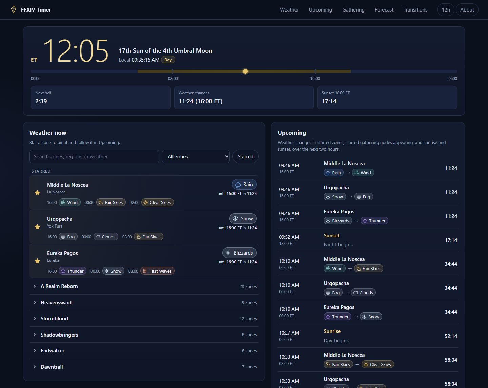

# FFXIV Timer

Eorzea Time, weather forecasts and weather transitions for FINAL FANTASY XIV. It is a static
page: no account, no backend, nothing to install, and nothing leaves your browser.



The build is made to be served at two addresses, with the first as the canonical one:

- https://radmagelabs.com/ffxiv/
- https://radmageirl.github.io/ffxiv-timer/

## What it does

- **Eorzea clock.** ET time, the Eorzean date (sun and moon), local time, day or night, and
  countdowns to the next bell, the next weather change and the next sunrise or sunset.
- **Weather now.** Current weather in every supported zone, how long it lasts, and the next
  three changes. Search by zone, region or current weather; filter by region; star zones.
- **Upcoming.** One timeline of weather changes in starred zones plus sunrise and sunset.
- **Forecast.** Any supported zone's weather odds and its next 12 to 72 weather periods, each with
  the weather before it.
- **Weather transitions.** Find when a zone changes from one weather to another ("Fog, then Heat
  Waves"), optionally only at 00:00, 08:00 or 16:00 ET, up to 30 days ahead. The search is in
  the address, so a link shares it and a reload or bookmark keeps it.

- **Timed gathering.** Every timed unspoiled and legendary node from A Realm Reborn through
  Dawntrail (189), with its items (level, stars, collectable), job and level, zone, area and map
  coordinates, folklore tome and spawn times. The list shows the nodes up now, ending soonest
  first, then the ones appearing within the next 15 minutes, 30 minutes or hour of real time
  (the default), soonest first; All drops the time limit. Filter by job, kind, expansion, level range, up now or starred, or set your
  Miner and Botanist levels and hide nodes above them; search matches items, places, tomes and
  expansions. Filters are remembered. Starred nodes show in Upcoming (marked "Up now" while they
  are up) and can remind you when they appear or a few minutes before. Reminders only work while
  the page is open in a tab, and system notifications also need your browser's permission
  (without it, reminders show on the page only).

Zones without a verified weather table are named as not supported. They never get a guess.

## How the forecast works

Weather in FFXIV is not random per player. Every eight bells (00:00, 08:00 and 16:00 ET, every
23 minutes 20 seconds of real time) the game turns the time into a number from 0 to 99 and walks
the zone's weather table, adding up percentages until the total passes that number. FFXIV Timer
does the same arithmetic (unsigned 32-bit, as the game does) on the same tables, so a forecast is
the weather the game will pick.

```
unix      = floor(real milliseconds / 1000)
bell      = floor(unix / 175)                 one bell = 175 real seconds
increment = (bell + 8 - bell % 8) % 24        00:00 -> 8, 08:00 -> 16, 16:00 -> 0
base      = floor(unix / 4200) * 100 + increment     (one sun = 4200 real seconds)
step1     = (base << 11) ^ base
step2     = (step1 >>> 8) ^ step1
roll      = step2 % 100
```

Eorzea Time runs 144/7 times faster than real time and reads 00:00 on the 1st Sun of the 1st
Astral Moon at the Unix epoch, the same zero the weather calculation uses. The game shows only the
time; the date here counts suns (days) and moons (32 suns each) from that zero.

## Where the data comes from

Weather tables and gathering nodes are generated from the game's own data tables for patch 7.57
hotfix 1 (TerritoryType, WeatherRate, Weather, PlaceName, ExVersion, GatheringPoint,
GatheringPointBase, GatheringItem, GatheringRarePopTimeTable and related tables), read from a
pinned commit of [xivapi/ffxiv-datamining](https://github.com/xivapi/ffxiv-datamining) with every
file's SHA-256 checked. `NOTICE` lists every source. All calculations are deterministic: the same
moment always gives the same answer, in every time zone.

## How it is checked

### Against reference data (done)

- Every supported weather table and gathering node is compared with a second, independent
  extraction of the game data from [XIVAPI](https://v2.xivapi.com).
- The weather roll was compared with two independent implementations,
  [ffxivweather](https://github.com/karashiiro/ffxivweather-py) and
  [eorzea-weather](https://github.com/flowercartelet/eorzea-weather), on 71,002 timestamps from
  2013 to 2045 with no differences. A sample of their results is kept as fixed test vectors.
- Every gathering node is compared with the node tables players keep on the
  [FFXIV wiki](https://ffxiv.consolegameswiki.com) (zone, spawn times, coordinates, item level and
  stars, folklore tome), read at pinned revisions. The game stores spawn lengths as hours and
  minutes (160 is two hours, 300 is three), which matches the wiki.
- The unit tests also check the roll against a BigInt version of the same arithmetic (including
  dates past the 32-bit wrap), the clock against the known real-time lengths of a bell, sun, moon
  and year, and the transition finder and node windows against brute-force searches.

### In the game (not done yet)

Nobody has yet compared these forecasts and node times with what the game itself shows (a
Skywatcher NPC, the weather on the minimap, a node appearing). Until that happens they are
computed from the game's data, not observed. Differences are welcome as
[issues](https://github.com/RadMageIRL/ffxiv-timer/issues).

## Run it locally

Open `index.html` in a browser. That is the whole app; there is no build step for development.

To see it the way each host serves it, run `node tools/serve.mjs` (Node 22 or later) and open:

- http://127.0.0.1:8017/dev/ (the source tree)
- http://127.0.0.1:8017/ffxiv-timer/ (the GitHub Pages build)
- http://127.0.0.1:8017/ffxiv/ (the same build as radmagelabs.com serves it)

## Tests

```
node tests/run.mjs        # unit tests: clock, weather, transitions, countdowns, data, build
node tests/smoke.mjs      # browser and base-path tests in headless Chrome (CHROME_PATH if needed)
node tools/screenshot.mjs # retake screenshots/ffxiv-timer.png at a fixed moment
```

Neither installs anything. The browser tests serve the built site under `/ffxiv-timer/`, through
an imitation of the radmagelabs.com proxy under `/ffxiv/`, and from the source tree and `file://`,
and fail on any request outside the base path.

## Weather data

```
node tools/build-weather.mjs           # regenerate js/weather-data.js (downloads into tools/.cache)
node tools/build-weather.mjs --check   # fail if js/weather-data.js is out of date
node tools/verify-weather.mjs          # compare every supported zone with XIVAPI
node tools/build-gathering.mjs         # regenerate js/gathering-data.js (and --check)
node tools/verify-gathering.mjs        # compare every node with XIVAPI and the wiki
```

Supported zones are listed in `data/supported-zones.json` by their game territory id. To add one:
add its id, rebuild, run `verify-weather.mjs --write-fixture`, and run the tests. Gathering nodes
work the same way from `data/supported-nodes.json` (game GatheringPointBase ids) with
`verify-gathering.mjs --write-fixtures`. A new game patch
means a new pinned commit and new hashes in `tools/lib/gamedata.mjs`.

## Hosting

Every path inside the site is relative and all view state lives in the address after `#`, so the
same files work under any base path and a reload never asks the server for a path that does not
exist. `tools/build.mjs` makes a copy for a hosting target in `deploy/targets.json` and adds only
what must be absolute: the canonical URL, a 404 page that sends visitors back to the app under the
base path they came in on, and version stamps on every file.

- `pages` is the deployed build. GitHub Pages serves it at `/ffxiv-timer/`, and radmagelabs.com
  proxies `/ffxiv/` to the same files.
- `labs` is a standalone copy laid out for a host that serves the files under `/ffxiv/` itself.

`.github/workflows/pages.yml` tests, builds and deploys the `pages` target on every push to
`main`; a commit that fails the tests is not deployed.

Settings and starred zones are saved in the browser under keys starting with `ffxiv-timer:`. Each
address is its own browser origin, so the two addresses keep separate settings.

## Project layout

```
index.html              the page
css/style.css
js/eorzea.js            Eorzea Time math (no time zone, shared with the tests)
js/weather.js           weather roll, forecasts, transition search
js/weather-data.js      generated weather tables
js/gathering.js         gathering node windows
js/gathering-data.js    generated gathering nodes
js/format.js            countdown text and URL keys
js/store.js             saved settings
js/icons.js             weather icons
js/app.js               the page logic
data/                   which zones and nodes are supported
deploy/targets.json     hosting targets and base paths
tools/                  data generator, data check, build, local server, screenshot
screenshots/            the README screenshot
tests/                  unit tests, browser tests, fixtures
```

## License and credits

The code is MIT licensed (see `LICENSE`). `NOTICE` lists what the license does not cover.

FINAL FANTASY XIV &copy; SQUARE ENIX. Zone and weather names and weather percentages come from the
game and are used under the FINAL FANTASY XIV Materials Usage Policy. FFXIV Timer is a free fan
tool and is not affiliated with or endorsed by Square Enix. The icons are original; no game images
are used.
